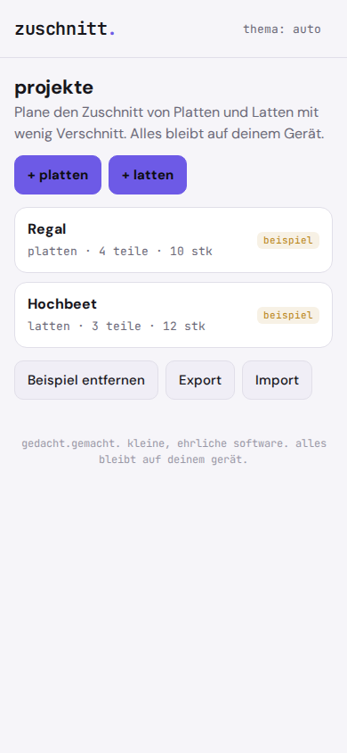
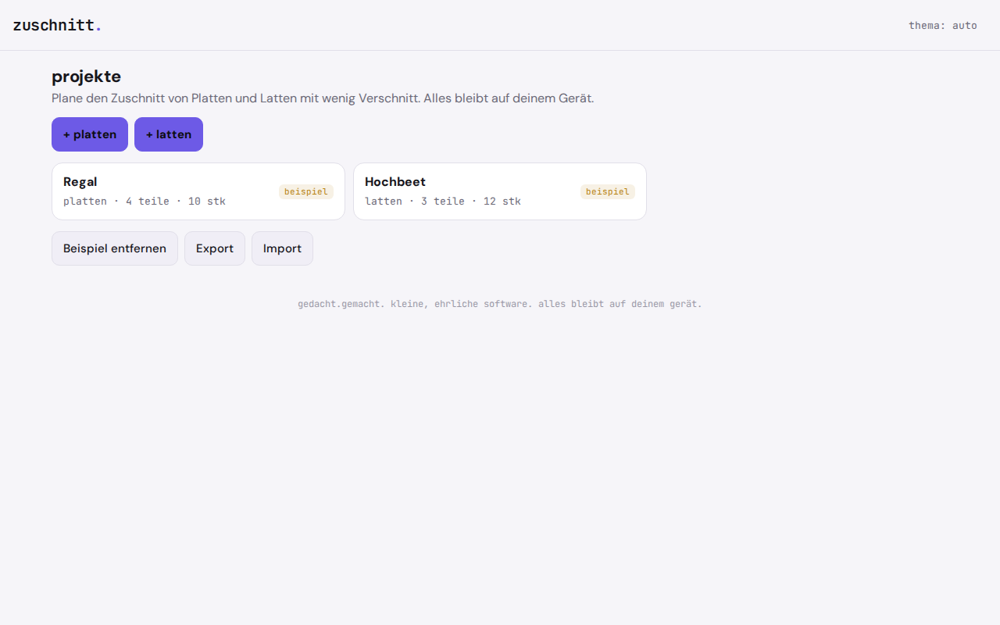

# zuschnitt.

**How many sheets do you need, and how do you cut them?** zuschnitt. is a cut list planner for sheet goods (plywood, MDF, chipboard) and boards or battens, with little waste.

It is a single page in the browser that works offline as a PWA, needs no account and keeps your projects on your phone. Enter the stock size and your parts, and you get a drawn cutting plan you can print.

   

**Try it:** https://gedachtgemacht.github.io/zuschnitt/ (works in any phone browser, install via "Add to Home Screen")

The app interface is in German.

If you buy sheets or boards at the hardware store, you want to know beforehand how many you need. Usable cut list planners are web services with an account or a subscription, desktop programs for Windows only, or tools for developers. Simple calculations often forget the saw kerf: three pieces of 800 mm don't fit into a 2400 mm board when the saw blade eats 4 mm. zuschnitt. accounts for the kerf, shows the cutting plan as a drawing and can be printed.

Plain arithmetic, no AI, no server. Everything stays on your phone.

<p align="center">
  
  
</p>

## Why

Paid cut list planners are often too much for occasional DIY work: an account, a subscription, limits in the free tier, sometimes Windows only. zuschnitt. is a single page in the browser: open it, type in your measurements, see the plan, print it. What it adds is access, not a better algorithm.

## Features

- **Projects**: create, rename and delete, each one for sheets (2D) or boards (1D)
- **Stock material**: one size per project, kerf in mm (default 4), optional price per piece
- **Parts list** with name, length, width, quantity, and for sheets the switch **Maserung beachten** ("respect grain"), meaning the part must not be rotated
- **Result**: number of sheets or boards, material usage in percent, cost, and a list of parts that don't fit, with the reason
- **Cutting plan** as a drawing to scale for each sheet or board, parts labelled with name and size, offcuts with their size
- **Print view**, one plan per page
- **Export and import** as a JSON file; import adds projects and overwrites nothing
- **Example projects**, removable with one click
- Light and dark theme, works offline, installable as an app

## Privacy

Nothing leaves your device. zuschnitt. has no server, no account, no analytics, no ads, and loads nothing from the network. Your projects are kept only in your browser's local storage (`localStorage`). Exports only happen when you trigger them yourself.

Because the data lives only in the browser: if you clear the site data, you also delete your projects. Export important projects now and then.

## Install

zuschnitt. is a static web app. There is no build step and there are no dependencies.

1. Put the `zuschnitt/` folder on any static host (your own web space, GitHub Pages, Netlify, a Raspberry Pi). Installing it as an app requires HTTPS.
2. Open the address in your phone's browser.
3. In the browser menu choose **Add to Home Screen**. After that zuschnitt. starts like an app and also works without a connection.

Test locally:

```
cd zuschnitt
python3 -m http.server 8000
```

Then open `http://localhost:8000` in your browser.

## How the math works

All measurements are whole millimetres. Parts are expanded into single pieces according to their quantity. The calculation functions in `zuschnitt.js` are pure functions without dependencies.

**Boards.** First Fit Decreasing: pieces sorted by length, longest first, ties in input order. Each board keeps track of how much is already used. A piece of length `l` fits if `used + l` is at most the board length. After that, `used` grows by `l` plus the kerf. The piece goes into the first board where it fits, otherwise into a new one. Example: 3 × 800 mm in a 2400 mm board with a 4 mm kerf. Two pieces use 1608 mm, the third would need 2408 mm and goes into a second board.

**Sheets.** Guillotine cuts with a list of free rectangles. Pieces sorted by area, largest first. For each piece, among all open sheets and free rectangles, the position with the smallest leftover area is chosen; on a tie, the one with the smaller short leftover side. Unrotated and, if the grain allows it, rotated. If nothing fits, a new sheet is started. After placing the piece in the top left corner, the free rectangle is split into two new ones, each reduced by the kerf.

**Figures.** Material usage = sum of part areas (for boards: part lengths) ÷ total area (or total length) of all stock pieces used, one decimal place. Cost = count × price.

**Limits, stated openly:**

- The calculation is a heuristic. It produces good plans, but no proof that they are the best. Sometimes it needs one stock piece more than necessary.
- Guillotine cuts only, no trimming of sheet edges, no cutting order, no edge banding.
- One stock size per project, no offcuts kept as inventory, no inch units.
- At most 500 pieces per project.
- Real sheets from the hardware store have rough edges. Choose a generous kerf.

The calculation functions are tested against hand calculations with `node test-calc.js`.

## License

GNU Affero General Public License v3.0 (AGPL-3.0), see `LICENSE`.

**Deutsch:** zuschnitt. ist ein Zuschnittplaner für Platten und Latten, der Verschnitt und Schnittfuge mitrechnet und einen druckbaren Schnittplan zeigt, offline als PWA und ohne Konto.

---

**gedacht.gemacht.** Small, honest software. Everything stays on your device. · [More projects](https://github.com/gedachtgemacht)
